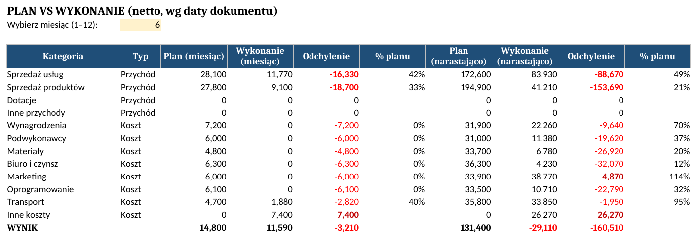
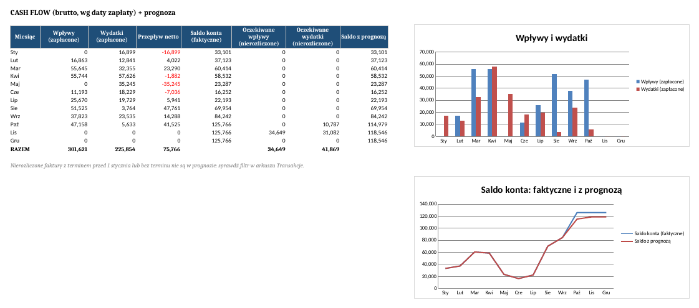
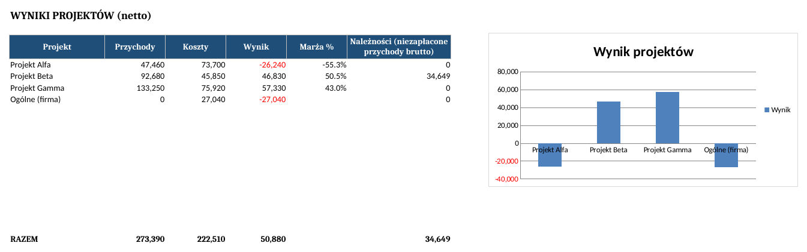

# Arkusz budżetu spółki

Demo przygotowane do oferty na zlecenie. Dane fikcyjne.

**Problem:** spółka potrzebuje jednego miejsca do planowania budżetu, śledzenia przychodów i kosztów w projektach oraz kontroli przepływów pieniędzy.

**Rozwiązanie:** plik [Budzet_spolki_DEMO.xlsx](Budzet_spolki_DEMO.xlsx), 7 zakładek:
- **Transakcje:** przychody i koszty, projekty, kategorie, netto/VAT/brutto, automatyczny status płatności,
- **Plan:** budżet miesięczny,
- **Plan vs Wykonanie:** wybór miesiąca, odchylenia za miesiąc i narastająco, przekroczenia na czerwono,
- **Cash flow:** wpływy, wydatki, saldo konta, prognoza z nierozliczonych faktur, wykresy,
- **Projekty:** wynik, marża i należności każdego projektu.

**Weryfikacja:** 28 sum kontrolnych zgodnych z niezależnym rachunkiem w Pythonie, 0 błędów formuł po przeliczeniu. Bez makr.

`buduj.py` odtwarza plik od zera (`pip install openpyxl`, `python3 buduj.py`).

