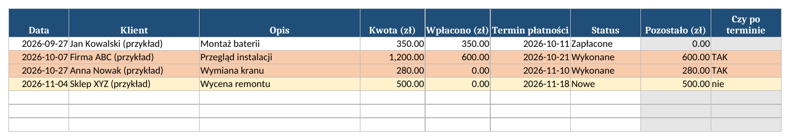
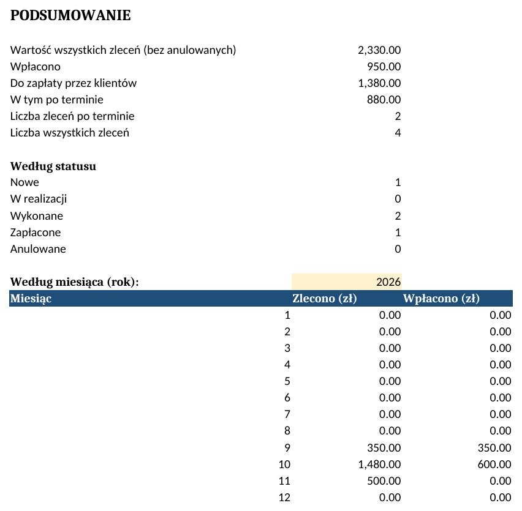

# Ewidencja zleceń i płatności

Gotowy arkusz dla małej firmy usługowej: [Ewidencja_zlecen_i_platnosci.xlsx](Ewidencja_zlecen_i_platnosci.xlsx).

- wpisujesz zlecenie, kwotę, wpłatę i termin, a status wybierasz z listy,
- arkusz sam liczy, ile zostało do zapłaty, i oznacza płatności po terminie (czerwone wiersze),
- podsumowanie: należności, zaległości, wyniki według statusu i miesięcy,
- przygotowany na 500 zleceń, z instrukcją w pliku.

`buduj.py` odtwarza plik od zera.

