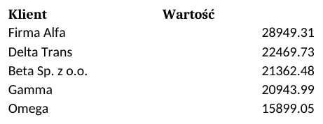

# Automatyczny raport z 12 plików Excel

**Problem:** 12 miesięcznych plików z różnymi nazwami kolumn, zbędnymi spacjami, pustymi wierszami i duplikatami.

**Rozwiązanie:** skrypt łączy pliki, czyści dane i tworzy [raport_sprzedazy.xlsx](raport_sprzedazy.xlsx) z zestawieniami (miesiące, klienci, produkty).

**Wynik (dane fikcyjne):** 12 plików → 230 wierszy, 24 puste lub zduplikowane wiersze usunięte automatycznie.

```bash
pip install openpyxl
python3 generuj_dane.py     # tworzy przykładowe pliki w dane_wejsciowe/
python3 polacz_raport.py    # tworzy raport_sprzedazy.xlsx
```


