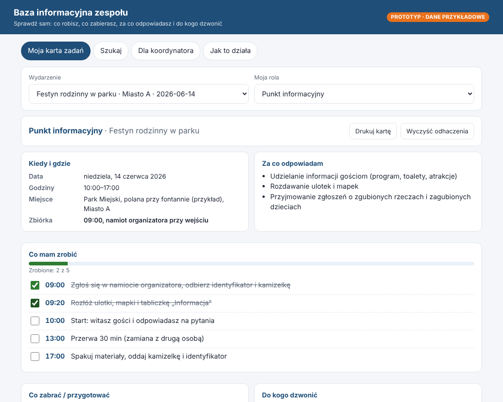
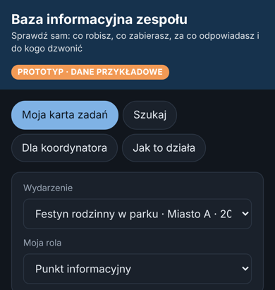
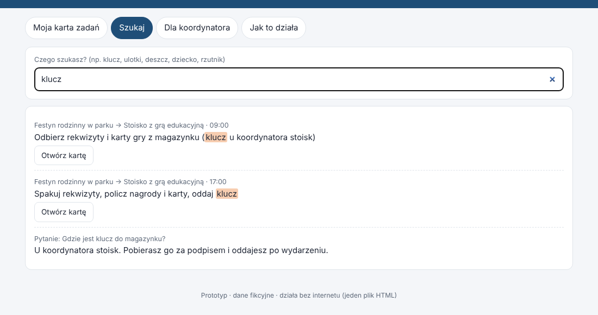
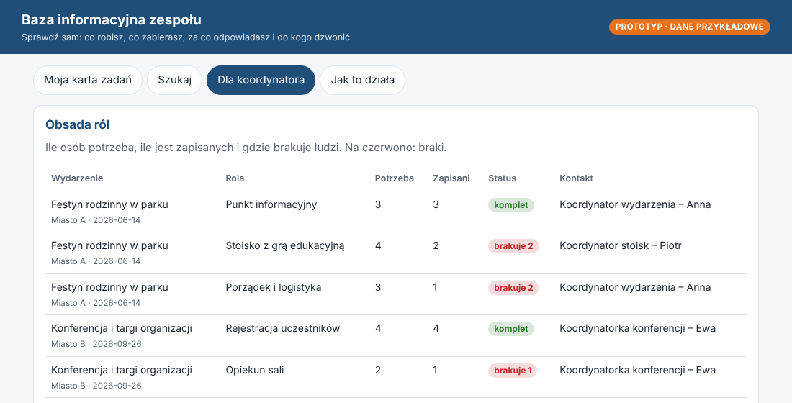

# Baza informacyjna dla zespołu przy wydarzeniach

Prototyp aplikacji webowej w jednym pliku: [index.html](index.html). **[Otwórz demo w przeglądarce](https://dawidnec5.github.io/Portfolio/05_baza_informacyjna/)** Działa w przeglądarce na komputerze i telefonie, bez instalacji i bez internetu. Dane fikcyjne.

**Problem:** członkowie zespołu dzwonią do koordynatora z pytaniami: co mam zrobić, co przygotować, za co odpowiadam, gdzie jest zbiórka.

**Rozwiązanie:**
- wybierasz wydarzenie i swoją rolę i widzisz kartę: kiedy i gdzie, obowiązki, harmonogram z odhaczaniem (zapamiętuje się na telefonie), co zabrać, kontakty z numerem do kliknięcia, zasady,
- wyszukiwarka po wszystkich kartach i pytaniach,
- widok koordynatora: gdzie brakuje osób,
- wydruk karty, tryb ciemny.

Docelowo dane może wpisywać koordynator w zwykłym arkuszu Google (zakładki: Wydarzenia, Role, Zadania, Do zabrania, Kontakty, Pytania).

 
 
