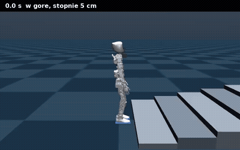
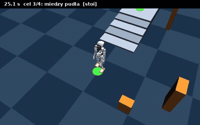
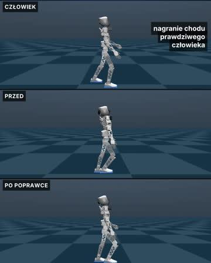
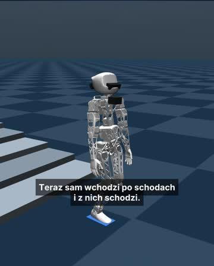
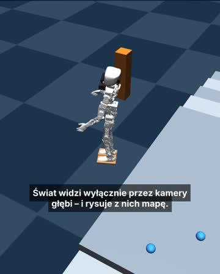

# Robot humanoidalny uczący się chodzić

Projekt własny: wirtualny robot (ok. 80 cm) w fizycznej symulacji MuJoCo uczy się chodzić metodą prób i błędów (uczenie ze wzmocnieniem, PPO). Treningi uruchamiałem na darmowych serwerach z GPU.

- naśladowanie nagrania chodu człowieka, potem samodzielne korekty,
- testy: schody 48/48, nierówny teren 32/32,
- nawigacja: robot sam wyznacza drogę do kolejnych celów, omijając przeszkody,
- prace nad tańszą wersją robota (64 cm), którą da się zbudować.

 

Filmy w pełnej jakości: [schody](video/schody.mp4) · [misja z kilkoma celami](video/misja.mp4)

  

Model robota: Poppy Humanoid (Poppy Project, CC BY-SA).
