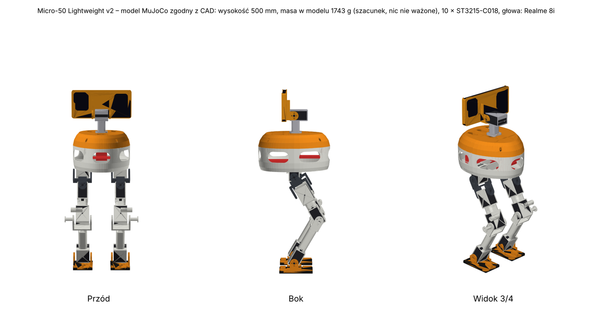
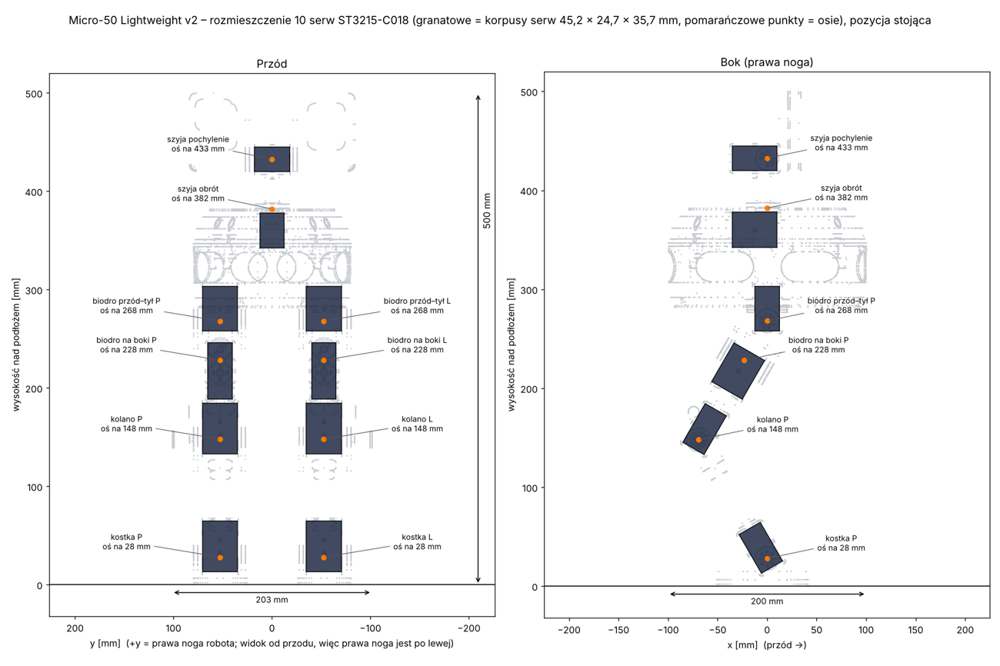
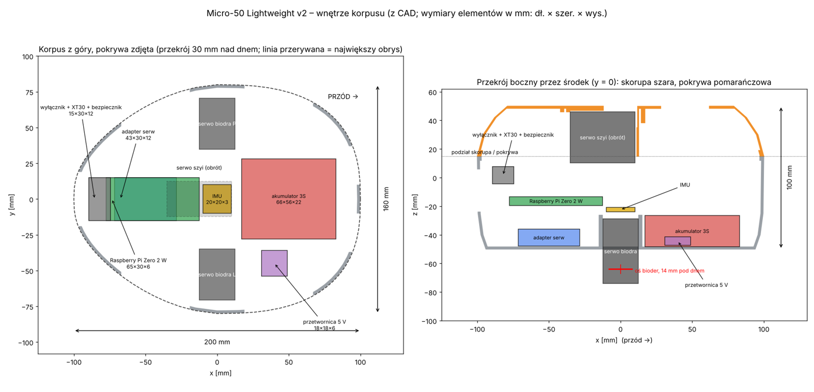
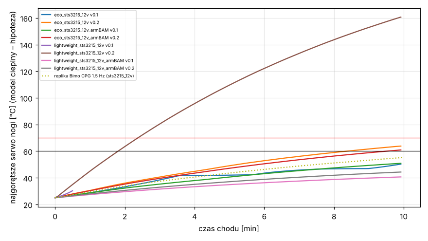

# Micro-50: projekt robota dwunożnego 50 cm

Projekt własny na bazie otwartego robota Open Duck Mini v2. Cel: tani robot dwunożny wysokości 50 cm (10 serw ST3215, Raspberry Pi Zero 2 W, telefon jako głowa) i **sprawdzenie w symulacji przed zakupem części**, czy serwa to udźwigną.

**Co zrobiłem**
- model MuJoCo zgodny z CAD (wysokość 500 mm, masa w modelu ok. 1,74 kg, szacunek),
- budżet masy element po elemencie, rozmieszczenie serw i elektroniki, plan zasilania,
- trening chodu (CMA-ES, PPO), pomiary momentów i temperatury serw w setkach przebiegów symulacji,
- **audyt własnych wyników:** znalazłem błędy w teście i regulatorze kursu, wycofałem zbyt optymistyczne wnioski i zaplanowałem pomiar jednego serwa przed zakupem kompletu.

Wszystkie liczby pochodzą z symulacji. Robot nie jest jeszcze zbudowany.

 

Projekt bazowy: Open Duck Mini v2 (Antoine Pirrone, Apache 2.0).
