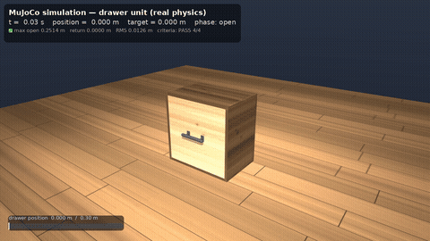
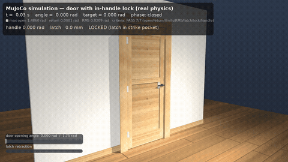
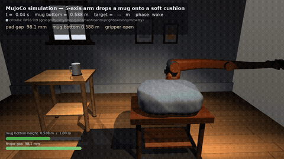
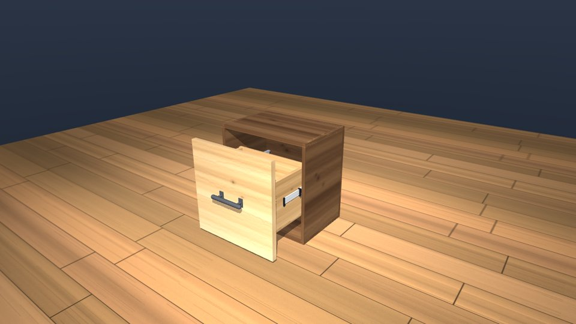
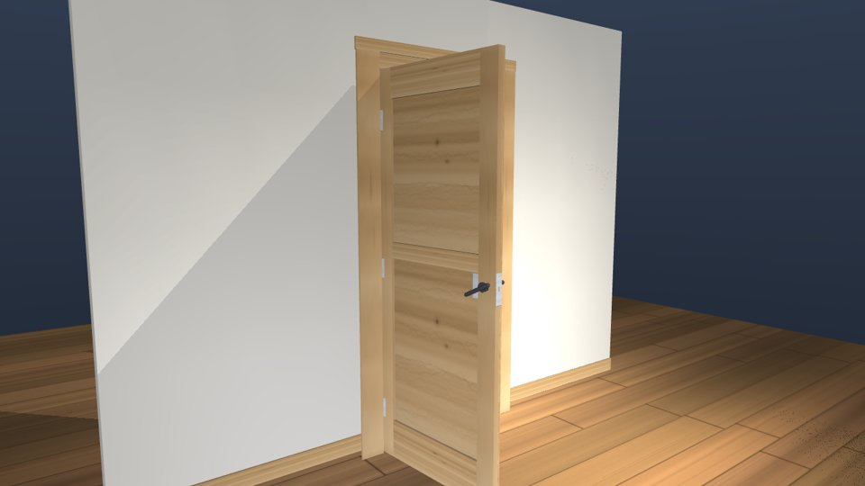
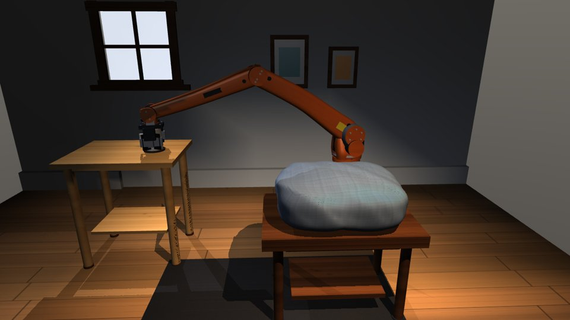
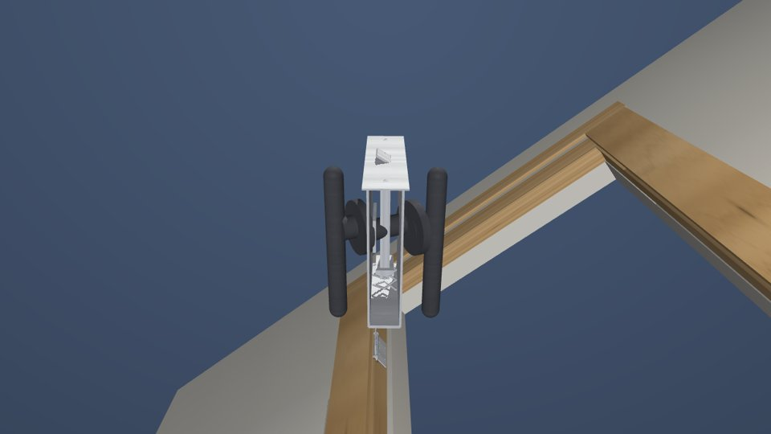
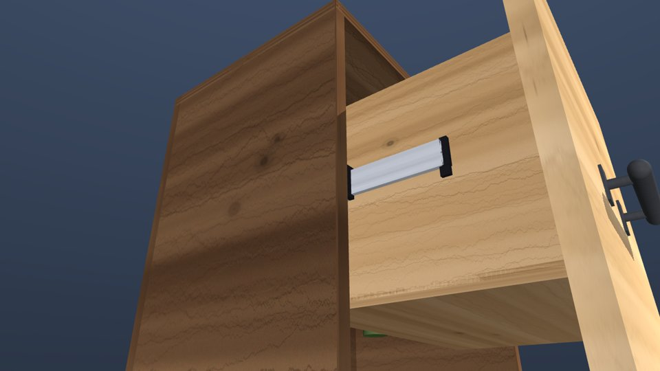
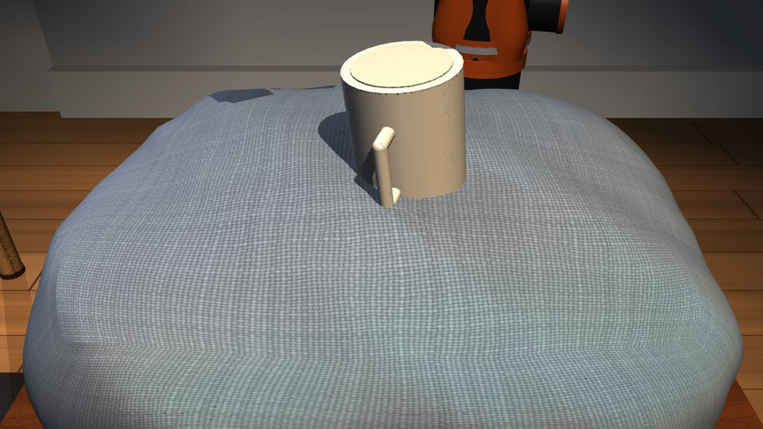

# Biblioteka assetów symulacyjnych MuJoCo

Trzy modele gotowe do symulacji (MJCF, MuJoCo 3.17) ze sprawdzoną fizyką, automatycznymi testami akceptacyjnymi i filmami demo. Nacisk na to, żeby modele **zachowywały się poprawnie w symulatorze**, a nie tylko dobrze wyglądały: skala i jednostki, masy i bezwładności, oddzielona geometria wizualna i kolizyjna, przeguby z osiami, limitami i napędami.

| Model | Co pokazuje | Wynik testu |
|---|---|---|
| **Szafka z szufladą** | przegub przesuwny, prowadnice teleskopowe z łożyskami, luźne przedmioty w szufladzie | otwarcie 0,251 m, powrót 0,000 m, błąd śledzenia RMS 0,013 m: **PASS 4/4** |
| **Drzwi z zamkiem w klamce** | zawiasy, zamek wpuszczany (klamka → krzywka → zapadka na sprężynie), który fizycznie trzyma drzwi | otwarcie 85°, zapadka cofnięta 15,7 mm przy otwieraniu: **PASS 7/7** |
| **Stanowisko z ramieniem 5-osiowym** | kinematyka odwrotna, chwytak, kubek jako swobodna bryła, odkształcalna poduszka (siatka sprężyn) | chwyt 22 N, uderzenie 1,66 m/s, wgniecenie 29–32 mm: **PASS 9/9** |

**Walidacja:** skrypt sprawdza każdy model (ładowanie, masy, bezwładności, limity, napędy, kontakty, materiały, nazewnictwo, zachowanie w demo). Wynik: **42 × PASS, 0 ostrzeżeń, 0 błędów**, szczegóły w [validation_report.md](validation_report.md). Do tego testy pytest.

Narzędzia: MuJoCo 3.17, Python, numpy, Pillow, pytest, ffmpeg.

## Filmy

  

Pełna jakość (1280×720): [szuflada](video/drawer_demo.mp4) · [drzwi](video/door_demo.mp4) · [ramię i kubek](video/pickplace_demo.mp4)

## Zbliżenia

  
  

Pliki modeli (MJCF, siatki, tekstury, skrypty) udostępniam na życzenie.
