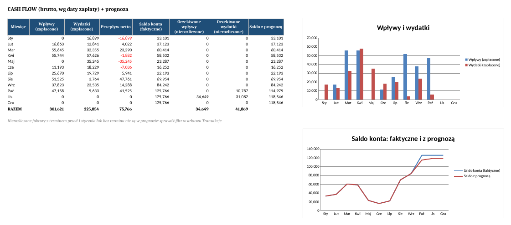
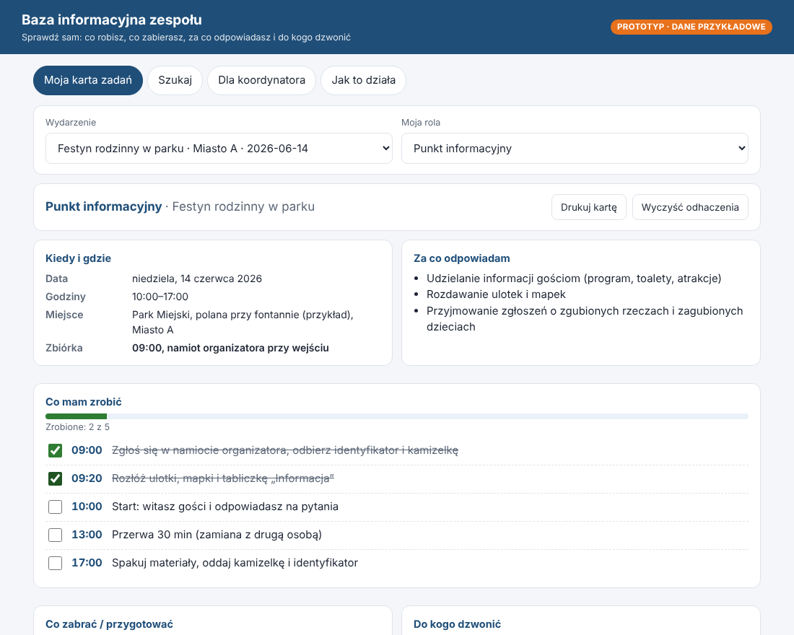
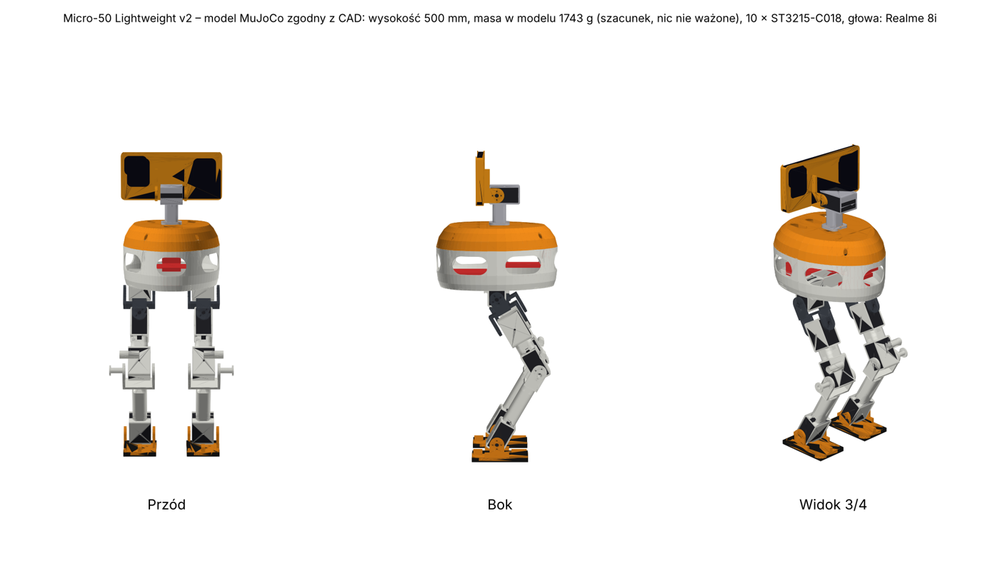
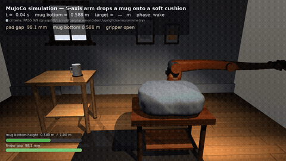

# Portfolio

Arkusze, automatyzacje, porządkowanie danych, aplikacje webowe i symulacje fizyczne (MuJoCo). Pracuję z narzędziami AI (Claude Code, Codex): AI pisze kod według mojego planu, a ja testuję, sprawdzam liczby niezależnie i odpowiadam za wynik.

**Wszystkie dane w przykładach są fikcyjne.** Każdy folder ma własny opis, pliki do pobrania i zrzuty ekranu. Całość w jednym pliku: [Portfolio.pdf](Portfolio.pdf).

**Działające demo w przeglądarce:** [baza informacyjna dla zespołu](https://dawidnec5.github.io/Portfolio/05_baza_informacyjna/)

| # | Projekt | Technologie | Folder |
|---|---|---|---|
| 1 | Arkusz budżetu spółki: plan, wykonanie, cash flow, projekty | Excel, formuły bez makr | [01_budzet_spolki](01_budzet_spolki) |
| 2 | Ewidencja zleceń i płatności dla małej firmy | Excel | [02_ewidencja_zlecen](02_ewidencja_zlecen) |
| 3 | Automatyczny raport z 12 plików Excel | Python | [03_raport_z_12_plikow](03_raport_z_12_plikow) |
| 4 | Czyszczenie i deduplikacja listy klientów | Python | [04_czyszczenie_csv](04_czyszczenie_csv) |
| 5 | Baza informacyjna dla zespołu przy wydarzeniach | HTML, JavaScript | [05_baza_informacyjna](05_baza_informacyjna) |
| 6 | Micro-50: projekt robota dwunożnego 50 cm | MuJoCo, Python, CAD | [06_micro50](06_micro50) |
| 7 | Biblioteka assetów symulacyjnych: szuflada, drzwi z zamkiem, ramię z kubkiem | MuJoCo, Python, pytest | [07_mujoco_assety](07_mujoco_assety) |

## Podgląd

 
 

## Jak pracuję

- Najpierw rozumiem problem: co zajmuje czas, kto będzie z narzędzia korzystał i jak sprawdzimy, że działa.
- Wyniki sprawdzam niezależnie (np. sumy w arkuszu porównuję z osobnym rachunkiem w Pythonie).
- Do narzędzi AI trafiają tylko dane przykładowe. Gotowe narzędzie działa u odbiorcy, na jego plikach.
- Wolę proste rozwiązania: zwykłe formuły zamiast makr, krótka instrukcja, możliwość edycji bez programisty.
